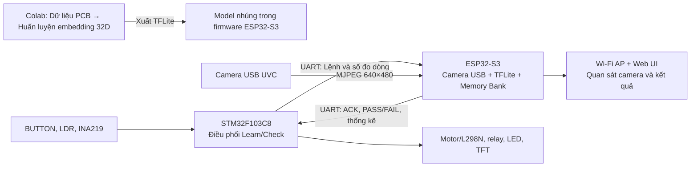

# VEDC — Hệ thống kiểm tra chất lượng PCB bằng thị giác máy và đo dòng điện

> **Mục tiêu của VEDC:** Xây dựng một trạm kiểm tra PCB bán tự động, có thể đưa bo mạch đến đúng vị trí, kiểm tra lỗi ngoại quan, đo dòng điện và trình bày kết quả rõ ràng cho người vận hành. Hệ thống hướng đến một quy trình kiểm tra nhất quán, dễ quan sát và có thể tiếp tục hiệu chuẩn trên dây chuyền thực tế.

Một PCB đi qua VEDC theo trình tự: **băng chuyền đưa PCB tới vị trí chụp → cảm biến dừng Motor → Camera và AI kiểm tra bề mặt → PCB đạt ngoại quan được đo dòng → kết quả hiển thị trên TFT và WEB → băng chuyền nhận PCB tiếp theo**. PCB lỗi ngoại quan được kết luận ngay và bỏ qua bước cấp nguồn đo dòng.

## Hệ thống giải quyết bài toán gì?

Kiểm tra PCB cần quan sát những lỗi nhỏ trên bề mặt, đồng thời xác nhận đặc tính điện của bo mạch sau khi cấp nguồn. VEDC kết hợp hai phép kiểm tra này trong cùng một quy trình do **STM32F103C8** điều phối. **ESP32-S3** nhận ảnh từ camera USB, chạy model AI và so sánh PCB đang kiểm tra với các PCB mẫu đạt chuẩn. Người vận hành theo dõi từng bước trên màn hình TFT và giao diện web.

Các điểm chính của thiết kế:

- **Kiểm tra theo hai tầng:** ngoại quan trước, dòng điện sau. Kết quả cuối phản ánh cả hình ảnh lẫn phép đo `Imax`/`Iavg` khi PCB qua bước ngoại quan.
- **Dừng đúng vị trí kiểm tra:** LDR và tia laser phát hiện PCB; STM32 dừng băng chuyền để camera chụp và người vận hành thực hiện bước kế tiếp.
- **Học mẫu chuẩn tại máy:** Sau khi huấn luyện model nền trên Colab, chế độ Learn lấy 5 ảnh và 5 mẫu dòng của PCB đạt chuẩn để tạo Memory Bank và ngưỡng cho điều kiện kiểm tra hiện tại.
- **Kết quả có thể quan sát:** Web UI hiển thị ảnh PCB đã căn chỉnh và đánh dấu các vùng patch vượt ngưỡng; TFT hiển thị trạng thái thao tác và PASS/FAIL.
- **Phân công rõ ràng:** STM32 điều khiển phần cứng và trình tự; ESP32-S3 xử lý camera, AI, lưu mẫu học và phục vụ giao diện web.

Đây là nền tảng để thử nghiệm và hoàn thiện một trạm kiểm tra PCB. Ngưỡng, ánh sáng, vị trí camera và thời gian xử lý cần được kiểm chứng trên PCB và phần cứng thực tế trước khi áp dụng cho sản xuất.

### Kết quả bước đầu và đích đến của dự án

Notebook đã tạo được checkpoint và xuất các biến thể TFLite; bản **`pcb_embedding_64_i8in_f32out.tflite`** nằm trong project ESP32-S3 là model mà firmware sử dụng. Trong lần đánh giá ghi lại ở notebook, bài toán phân loại **7 lớp đạt 79,31% accuracy trên 493 patch validation**; phép đánh giá điểm bất thường của embedding đạt **PR-AUC 0,9936**. Đây là kết quả của **dữ liệu Kaggle** với **24 patch bình thường và 469 patch lỗi** trong tập validation, nên chưa phải tỷ lệ PASS/FAIL của toàn hệ thống trên PCB thực.

Đích đến của VEDC là một chu trình vận hành có thể lặp lại: người vận hành Learn từ PCB chuẩn, băng chuyền đưa từng PCB vào vị trí, hệ thống xác định **vùng ngoại quan bất thường** và **dòng điện lệch chuẩn**, rồi hiển thị đủ thông tin để kiểm tra lại và điều chỉnh ngưỡng. Các chỉ số cần đo tiếp trên máy thật gồm tỷ lệ báo sai/bỏ sót, thời gian xử lý mỗi PCB và độ ổn định khi chạy nhiều PCB liên tiếp.

## Nội dung repository

```text
.
├── README.md
├── STM32F102C8T6/                 # Firmware STM32F103C8 (Keil)
│   ├── MDK/ok.uvprojx
│   ├── MDK/my_lib/
│   └── USER/main.c
├── ESP32S3_CAM/             # Firmware ESP32-S3 (ESP-IDF)
│   ├── main/                        # Mã ứng dụng và model .tflite
│   ├── components/
│   └── web/
└── PCB_Train_1_Colab.ipynb # Notebook huấn luyện/xuất model
```

Điểm bắt đầu để đọc mã: [STM32 `main.c`](STM32F102C8T6/USER/main.c), [`learn_flow.c`](STM32F102C8T6/MDK/my_lib/learn_flow.c), [`check_flow.c`](STM32F102C8T6/MDK/my_lib/check_flow.c), [ESP32 `main.c`](ESP32S3_CAM/main/main.c), [`vedc_controller.c`](ESP32S3_CAM/main/vedc_controller.c) và [notebook Colab](PCB_Train_1_Colab.ipynb).

## Kiến trúc và luồng dữ liệu



1. **Colab — huấn luyện trước khi triển khai:** Notebook tạo patch ảnh, huấn luyện MobileNetV2 để trích embedding **32 chiều** và xuất model TFLite. Firmware ESP32-S3 đã nhúng file [`pcb_embedding_64_i8in_f32out.tflite`](ESP32S3_CAM/main/pcb_embedding_64_i8in_f32out.tflite), với đầu vào patch RGB **64×64×3 `int8`** và đầu ra embedding **32 chiều `float32`**. Không cần chạy Colab mỗi lần khởi động hay mỗi lần Learn.
2. **STM32 — bộ điều phối:** Đọc nút bấm và LDR, điều khiển motor bằng PWM qua L298N, đóng/ngắt relay để cấp nguồn PCB khi đo, đọc INA219 và cập nhật màn hình TFT. STM32 quyết định thời điểm gửi từng lệnh cho ESP32-S3.
3. **ESP32-S3 — xử lý ảnh và so sánh:** Camera USB UVC cung cấp MJPEG **640×480**. ESP32 tìm PCB trong ảnh, căn chỉnh thành ảnh RGB **640×448**, cắt lưới **13×9 = 117 patch** kích thước **64×64**, bước trượt **48 pixel**, rồi chạy model trên từng patch. Trong Learn, ESP32 dùng embedding từ 5 ảnh chuẩn để tạo **Coreset Memory Bank** và ngưỡng ảnh; trong Check, điểm khác biệt của từng patch được so với ngưỡng này.
4. **Web UI — quan sát:** ESP32 phát Wi-Fi AP và trang tại `http://192.168.4.1`. Trang hiển thị trạng thái Learn/Check, camera trực tiếp, ảnh PCB đã chuẩn hóa và vị trí patch lỗi. Các thao tác chụp, Learn và Check của quy trình chính được khởi phát từ **STM32**, không phải từ trình duyệt.

### Phân biệt hai bước “train”

| Bước | Chạy ở đâu | Đầu ra | Khi nào cần làm |
| --- | --- | --- | --- |
| Huấn luyện model embedding | Google Colab | Checkpoint và file `.tflite` | Khi tạo/cập nhật model nền |
| **Learn** trên thiết bị | STM32 điều phối, ESP32 xử lý | Memory Bank, ngưỡng ngoại quan và thống kê dòng điện lưu trên ESP32 | Khi lấy mẫu chuẩn cho bộ PCB/điều kiện chụp đang sử dụng |

Model TFLite là bộ trích đặc trưng đã được đóng vào firmware. **Learn không huấn luyện lại MobileNetV2**; nó tạo dữ liệu tham chiếu và ngưỡng từ các PCB chuẩn được chụp tại máy.

## Phần cứng và đấu nối

### STM32F103C8

| Chân STM32 | Thiết bị/tín hiệu | Chức năng |
| --- | --- | --- |
| PB0 | Nút Learn | Vào chế độ lấy mẫu chuẩn |
| PB1 | Nút Capture | Chụp từng ảnh chuẩn trong Learn |
| PA1 | Nút Measure | Đo từng mẫu dòng chuẩn trong Learn |
| PA2 | Nút Train | Yêu cầu ESP32 tạo Memory Bank và ngưỡng |
| PA3 | Nút Check | Vào chế độ kiểm tra PCB |
| PA4 | Nút Visual | Yêu cầu kiểm tra ngoại quan PCB đang dừng |
| PA5 | Nút Power | Đo dòng PCB đã qua bước ngoại quan |
| PA0 | LDR module, chân DO | Nhận biết PCB che tia laser; có tia = `0`, bị che = `1` |
| PA11 / PA12 | L298N IN1 / IN2 | Chọn chiều chạy băng chuyền |
| PA15 | L298N ENA | PWM TIM2_CH1 remap; **tháo jumper ENA** trên L298N |
| PC14 | Relay cấp nguồn PCB | Active low: `0` = bật, `1` = tắt |
| PB6 / PB7 | INA219 SCL / SDA | I²C đo dòng |
| PB10 / PB11 / PB12 | TFT ST7735 DC / RST / CS | Tín hiệu điều khiển màn hình |
| PB13 / PB15 | TFT ST7735 SCK / MOSI | SPI2 hiển thị |
| PA6 / PA8 / PA7 | LED đỏ / vàng / xanh | Trạng thái nguồn / Learn / Check |

### Liên kết STM32 ↔ ESP32-S3

| STM32 USART1 | ESP32-S3 UART1 | Thiết lập |
| --- | --- | --- |
| PA9 TX | GPIO18 RX | TX nối chéo RX |
| PA10 RX | GPIO17 TX | RX nối chéo TX |
| GND | GND | GND chung, mức logic 3,3 V |

UART chạy **115200 baud, 8N1**. ESP32-S3 còn cần camera USB UVC hỗ trợ **MJPEG 640×480**; firmware được cấu hình cho board có **flash 16 MB và PSRAM octal 8 MB**.

## Trình tự vận hành

### 1. Khởi động

ESP32 mở UART sớm, sau đó khởi tạo USB Host/UVC, Wi-Fi AP, Web UI, bộ cắt patch, TFLite Micro và Memory Bank. Nếu đã có dữ liệu Learn hợp lệ trong flash, ESP32 thử khôi phục để dùng lại. STM32 khởi tạo ngoại vi, màn hình và vào trạng thái chờ. Chỉ thực hiện chụp/AI khi các phần xử lý của ESP32 đã sẵn sàng.

### 2. Learn — lấy mẫu PCB chuẩn

1. Đặt camera và PCB chuẩn đúng vị trí, nhấn **PB0**. STM32 gửi `LEARN_START`; ESP32 xác nhận và bắt đầu phiên Learn mới.
2. Nhấn **PB1** cho từng mẫu ảnh **1 đến 5**. Mỗi lần, ESP32 chụp một frame, nhận diện/căn chỉnh PCB, cắt patch và trích embedding; STM32 chỉ chuyển sang mẫu kế tiếp sau khi nhận `CAPTURE_ACK`.
3. Nhấn **PA1** cho từng mẫu dòng **1 đến 5**. STM32 bật relay, chờ ổn định, đọc INA219 trong khoảng đo **500 ms**, tắt relay, rồi gửi `Imax` và `Iavg` cho ESP32. ESP32 lưu mẫu và trả `POWER_ACK`.
4. Nhấn **PA2** khi đủ 5 ảnh và 5 mẫu dòng. ESP32 tạo Coreset Memory Bank, tính ngưỡng ảnh và thống kê/độ lệch dòng, lưu dữ liệu Learn vào flash, rồi trả `TRAIN_DONE`. TFT hiển thị số patch, kích thước bank và các ngưỡng.

Nếu INA219 báo lỗi I²C, màn hình yêu cầu thao tác đo lại. Nếu chụp ảnh, trích đặc trưng hoặc tạo Memory Bank thất bại, ESP32 trả lỗi và STM32 hiển thị trạng thái lỗi; nhấn **PB0** để bắt đầu lại Learn.

### 3. Check — kiểm tra từng PCB

1. Nhấn **PA3**. STM32 gửi `CHECK_START`; sau ACK, băng chuyền chạy. PWM mục tiêu trong **ZIP firmware STM32 là 83%**, khoảng **20 kHz**, tăng theo bước **1% mỗi 20 ms**.
2. LDR tại PA0 phát hiện PCB che tia liên tục **2 ms** thì STM32 **dừng motor ngay**. Hệ thống chỉ nhận PCB mới sau khi tia thông ổn định **300 ms**, tránh đếm lại PCB cũ.
3. Nhấn **PA4**. STM32 gửi `VISUAL_CHECK[board]`; ESP32 chụp, chuẩn hóa ảnh, chạy TFLite trên 117 patch và so điểm từng patch với ngưỡng Memory Bank. Nếu **ngoại quan FAIL**, lưu kết quả, **bỏ qua đo dòng** và chuyển sang PCB tiếp theo.
4. Nếu **ngoại quan PASS**, nhấn **PA5**. STM32 bật relay, đọc `Imax`/`Iavg` bằng INA219 rồi tắt relay. ESP32 so độ lệch với thống kê Learn và trả `POWER_RESULT` PASS/FAIL. Ngưỡng bảo vệ quá dòng phía STM32 là **1000 mA**; trường hợp quá dòng bị đánh dấu lỗi và ngắt relay.
5. STM32 gửi `CHECK_NEXT`, cho băng chuyền chạy lại và chờ PCB kế tiếp. Nếu PCB kế tiếp đến trong lúc chờ ACK, tác vụ LDR vẫn có thể dừng motor để giữ vị trí PCB.

Khi lỗi giao tiếp hoặc lỗi xử lý trong Check, STM32 dừng motor, tắt relay và báo lỗi trên TFT. Nhấn **PA3** để bắt đầu lại phiên Check. Điều kiện chụp quan trọng: camera phải thấy đủ bốn mép PCB; thuật toán hiện tìm PCB theo màu xanh và yêu cầu frame 640×480. Nếu không tìm được PCB, ESP32 trả lỗi thay vì cho kết quả PASS/FAIL.

## Giao thức UART

Frame hai chiều có dạng `0xAA | LEN | CMD | DATA | CRC8 | 0x55`. `LEN` là số byte DATA; CRC8 dùng đa thức `0x07`, tính trên `LEN + CMD + DATA`.

| STM32 → ESP32-S3 | Phản hồi | Ý nghĩa |
| --- | --- | --- |
| `0x10 LEARN_START` | `0xFF ACK` | Bắt đầu Learn |
| `0x11 CAPTURE_SAMPLE[idx]` | `0x91 CAPTURE_ACK` | Chụp một trong 5 ảnh chuẩn |
| `0x12 POWER_SAMPLE[idx,Imax,Iavg]` | `0x92 POWER_ACK` | Gửi một trong 5 mẫu dòng |
| `0x13 TRAIN_START` | `0x93 TRAIN_DONE` | Tạo Memory Bank và ngưỡng |
| `0x20 CHECK_START` | `0xFF ACK` | Bắt đầu Check |
| `0x21 VISUAL_CHECK[board]` | `0xA1 VISUAL_RESULT` | Kiểm tra ngoại quan |
| `0x22 POWER_CHECK[board,Imax,Iavg]` | `0xA2 POWER_RESULT` | Kiểm tra dòng điện |
| `0x23 CHECK_NEXT[board]` | `0xFF ACK` | Chuyển PCB kế tiếp |

ESP32 dùng `0x94 CMD_ERROR` khi không thể xử lý lệnh. STM32 gửi lại request theo chu kỳ nếu chưa nhận được phản hồi; ESP32 lưu phản hồi của transaction vừa xử lý để request lặp không chụp, train hay tăng số PCB lần thứ hai.

## Build, nạp và quan sát

### STM32F103C8

1. Mở [`STM32F102C8T6/MDK/ok.uvprojx`](STM32F102C8T6/MDK/ok.uvprojx) bằng **Keil µVision**.
2. Build target STM32F103C8, kiểm tra cảnh báo/lỗi và nạp bằng ST-Link qua SWD.
3. Kiểm tra [`MDK/my_lib/hw_config.h`](STM32F102C8T6/MDK/my_lib/hw_config.h) có `CONVEYOR_TARGET_DUTY 83U` trước khi nạp.

### ESP32-S3

Project khai báo ESP-IDF **≥ 5.0**. Cấu hình hiện có hướng tới ESP32-S3 N16R8, flash 16 MB và PSRAM octal 8 MB. Dùng môi trường ESP-IDF đã cài đặt, mở thư mục [`ESP32S3_CAM/`](ESP32S3_CAM/) và chạy:

```bash
idf.py set-target esp32s3
idf.py build
idf.py -p <PORT> flash monitor
```

Thay `<PORT>` bằng cổng nối tiếp của board (ví dụ `COM5` trên Windows). Nếu `set-target` làm tạo lại cấu hình, kiểm tra lại flash 16 MB, PSRAM octal, bảng phân vùng `partitions.csv` và thiết lập trong `sdkconfig.defaults` trước khi nạp. File model `.tflite` được khai báo trong `main/CMakeLists.txt` và nhúng vào binary khi build.

Kết nối camera với cổng USB Host của ESP32-S3; trong log cần thấy camera UVC chạy **MJPEG 640×480** và các module AI khởi tạo thành công. ESP32 phát AP mặc định tên **`VEDC_ESP32`**; cấu hình tên/mật khẩu trong `sdkconfig` hoặc `idf.py menuconfig`, sau đó mở **`http://192.168.4.1`**. Web chỉ hiển thị trạng thái, luồng camera và ảnh/kết quả kiểm tra; nút trên STM32 điều khiển quy trình.

### Notebook Colab

Mở [notebook](PCB_Train_1_Colab.ipynb) trên Google Colab khi cần huấn luyện hoặc xuất lại model. Notebook tải dữ liệu PCB từ Kaggle bằng Colab Secret `KAGGLE_API_TOKEN`, chia dữ liệu theo `board_id`, tạo patch/ảnh QA, huấn luyện MobileNetV2 với classification loss và triplet loss, đánh giá embedding, lưu checkpoint rồi xuất các biến thể TFLite. Dùng **bản `64_i8in_f32out`** cho firmware này.

Các chỉ số validation lưu trong notebook xuất phát chủ yếu từ patch Kaggle và là thông tin tham khảo cho lần train đó. Việc quyết định ngưỡng vận hành phải kiểm tra lại trên ảnh camera, PCB, ánh sáng và cơ cấu băng chuyền thực tế.


